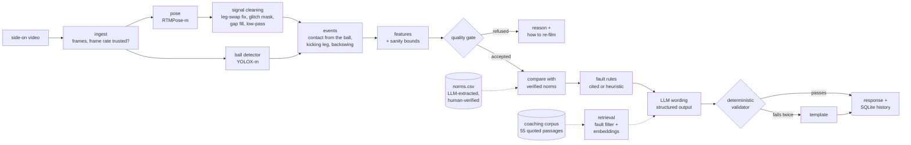

# KickCoach v2

KickCoach measures a footballer's instep kick from an ordinary side-on video: the knee angle at ball contact, how far the knee bends in the backswing, trunk lean and plant-foot position. It compares them with norms from published biomechanics studies and with the player's own past sessions, and explains what to work on.

The measuring is done by a pose model and deterministic code, never by an LLM. Every measurement is checked against hand labels, and a frontier video model (Gemini) is evaluated as an alternative measuring tool on the same labels. An LLM writes the feedback text from the measurements and from coaching passages retrieved from a small corpus of quoted sources, under a validator that rejects any number or citation it wasn't given.

v2 is a rebuild of [KickCoach](https://github.com/OkayWheresAamir/kickcoach-synapse.ai), which won 3rd place at the Synapse AI Hackathon (DTU, Feb 2026). The rebuild started with an audit of that version ([docs/V1_AUDIT.md](docs/V1_AUDIT.md)), and v1, replayed as it shipped, is the baseline in every comparison below.

**Live demo: https://okaywheresaamir--kickcoach-web.us-east.modal.run**. Upload a side-on clip of one kick, or open the example result. It runs on CPU (Modal); a 5 s clip took 60–107 s in six deployment runs (`deploy/smoke_test.py`). The demo keeps nothing on the server, and its feedback comes from templates rather than the LLM ([why](#run-the-app)).

## Results

<!-- results:start (generated by eval/run_all.py; edit there, not here) -->
| evaluation | result | n |
|---|---|---|
| Pose model (E1) | RTMPose: 85% of labelled joints within 0.1 thigh lengths (95% CI 81–89%); MediaPipe 65%; MoveNet (v1's model) 22% | 19 clips, 38 frames, 304 joints |
| Angle error vs labels (E2) | knee at contact 3.4° MAE (v1 12.8°); trunk lean 2.7° (v1 16.5°); max knee flexion 4.6° (v1 doesn't measure it) | 19 clips (5 held out) |
| Contact frame (E3) | within ±2 frames on 95% (v1 0%; peak foot speed 26%) | 19 clips |
| Gemini 3.8 Flash as the measuring tool (E4) | knee at contact 18.5° MAE, bias +18.4°, r +0.27; the pipeline on the same clips 2.7°, r +0.93 | 18 clips both answered |
| Norm extraction by LLM (E5) | 0 of 32 rows hallucinated; 512/512 fields right; recall 94% | 4 source papers + 2 controls |
| Impossible values (E8) | values beyond a sanity bound: v2 0 of 88; v1 6 of 78 | 26 clips |
| Velocities (E8) | reported only when the real capture rate is known: right on 26 of 26 clips (v1 2 of 26) | 26 clips |
| Camera-angle gate (E8) | refused 4 of 4 clips filmed from the wrong angle and 0 of 21 good ones (in-sample) | 25 clips |
| Retrieval of coaching passages (E6) | filter + embeddings: Recall@3 0.56, MRR 0.75; the fault filter alone 0.46 / 0.61; embeddings alone 0.29 / 0.50 | 9 queries (relevance labelled by Claude) |
| LLM feedback with retrieved passages | passed the deterministic validator first try on 14 of 15 | 15 clips with a fault |
| Feedback quality (E7) | not rated yet (Aamir's 20 ratings) | – |
| Labelling floor | not measured yet (the blind relabel hasn't been done) | – |
<!-- results:end -->

All of these come from `uv run python -m eval.run_all` (see [Reproduce the results](#reproduce-the-results)); the full tables are in [results/summary.md](results/summary.md) and each evaluation's `results/e*_summary.md`. MAE = mean absolute error against the angle computed from the hand-labelled keypoints with the same geometry code. Confidence intervals resample clips (2,000 bootstrap draws).

What the numbers say:
- **Most of v1's error was not the pose model's fault.** v1 picked the "kick" frame as the moment of highest ankle speed, which never landed within 2 frames of the real contact. It also mapped keypoints back through a letterbox it ignored, which squashes angles on landscape video. v2 finds contact from the ball, and the angle error falls accordingly ([E2](results/e2_summary.md), [E3](results/e3_summary.md)).
- **Gemini times the kick reasonably but doesn't measure angles.** Its knee angles at contact sit in a narrow, nearly straight band whatever the frame shows, so they barely track the labels. On the clips where it found contact within a frame of the label, the knee error stays as large ([E4](results/e4_summary.md), [failures](results/failures.md)). It also confabulated a "frozen video" on one clip, then "edited pauses" when asked again.
- **The pipeline refuses rather than guesses.** A value outside a sanity bound becomes `not_measured` with a reason; velocities are shown only on the clips whose real capture rate is known; and clips filmed from the wrong angle are refused with advice on how to re-film ([E8](results/e8_summary.md)).
- **n is small.** 19 labelled clips, 5 of them held out. The held-out rows in [results/summary.md](results/summary.md) are the ones no threshold was tuned on.
- **The labelling floor is still to come.** The labeller (Aamir) relabels a sample of frames blind, at least 48 h later, to measure his own consistency. No model can be shown to be more accurate than that ([results/repeatability_summary.md](results/repeatability_summary.md)).

## How it works



Everything up to the fault rules is deterministic code: an angle is a function of keypoints, and every threshold, norm or bound either cites a source or is marked `heuristic` in the code and the UI. The LLM appears in three places only, and none of them measures anything:
1. **Offline norm extraction.** `gemini-3.6-flash` extracts norm rows from open-access papers into a fixed schema, and a human verifies every row before the app may use it (E5 scores the extraction).
2. **Feedback wording.** `gemini-3.5-flash-lite` turns the detected faults, measured values, verified norms and retrieved coaching passages into text. A validator checks that every number is one it was given, that every citation is one of the provided IDs, that each fault is covered once, and that nothing marked `not_measured` is discussed. On failure it retries once with the errors, then falls back to a template. The app runs with no API key at all.
3. **The baseline (E4).** `gemini-3.8-flash` is asked to measure the same angles from the video, to test whether a frontier model could replace the pipeline.

| Stage | Code | Decision |
|---|---|---|
| Frame-rate trust: velocities only when the real time per frame is known | `kickcoach/ingest/` | [DEC-010](docs/DECISIONS.md) |
| Pose: RTMPose-m (Halpe26), chosen by E1 with a rule fixed in advance | `kickcoach/pose/` | [DEC-016](docs/DECISIONS.md) |
| Signal: Viterbi leg-swap fix, segment-length glitch mask, low-pass with a break at contact | `kickcoach/signal/` | [DEC-019](docs/DECISIONS.md), [DEC-025](docs/DECISIONS.md) |
| Events: contact from the ball's motion, with a calibrated shift when the ball is hidden at the touch | `kickcoach/events/` | [DEC-020](docs/DECISIONS.md), [DEC-022](docs/DECISIONS.md) |
| Features, sanity bounds and the camera-angle gate | `kickcoach/features/`, `kickcoach/quality/` | [DEC-021](docs/DECISIONS.md) |
| Comparison with verified norms (unit and angle conventions converted, never invented) | `kickcoach/compare/` | [DEC-026](docs/DECISIONS.md), [DEC-027](docs/DECISIONS.md) |
| Fault rules | `knowledge/faults.yaml` | [DEC-028](docs/DECISIONS.md) |
| LLM feedback under a validator | `kickcoach/feedback/` | [DEC-029](docs/DECISIONS.md) |
| Coaching corpus and retrieval (verbatim quotes; fault filter, then `gemini-embedding-2`) | `knowledge/coaching_corpus.yaml`, `kickcoach/retrieval/` | [DEC-037](docs/DECISIONS.md)–[DEC-039](docs/DECISIONS.md) |
| Storage and API | `kickcoach/storage/`, `api/` | [DEC-030](docs/DECISIONS.md) |

Every decision, with its alternatives and evidence, is in [docs/DECISIONS.md](docs/DECISIONS.md). The build log, including the dead ends, is in [docs/JOURNAL.md](docs/JOURNAL.md).

## Capture protocol

The measurements are 2D, so they assume the camera sees the kick from the side:
- the camera is side-on to the kicking direction, roughly perpendicular (within about 30°);
- it is at about hip height, level and not moving;
- the whole body and the ball are visible from the approach through the follow-through;
- one player is in frame; the kicking leg nearer the camera is preferred;
- for velocities, the clip is either real time at 120 fps or more, or slow motion whose capture rate you state. Otherwise velocities are withheld, and the angles are still measured.

A clip that fails the camera-angle check is refused with the reason and how to re-film. It gets no numbers.

## How it was evaluated

- **Clips:** 26 public videos of instep kicks, listed by URL and timestamps in [data/manifest.csv](data/manifest.csv). 23 are for evaluation (18 tuning, 5 held out) and 3 are filmed from behind, to test the gate. The video itself is never committed.
- **Ground truth:** hand labels in [data/labels/](data/labels/): the contact frame, the deepest-backswing frame, the kicking leg, whether the camera angle is usable, and keypoints on the backswing, contact and (optionally) contact − 1 frames. The labelling tool pre-fills keypoints from RTMPose and keeps the pre-fill, so the evaluations can measure, and correct for, anchoring to it ([labelling guide](docs/LABELLING_GUIDE.md)).
- **Evaluations** (one script each in [eval/](eval/)):

| ID | Question | Script |
|---|---|---|
| E1 | Which pose model places keypoints best on kicking frames? | `eval/e1_pose.py` |
| E2 | How close are the angles to the labels, v1 vs v2? | `eval/e2_angles.py` |
| E3 | Does ball-based contact detection beat peak foot speed? | `eval/e3_contact.py` |
| E4 | Can a frontier video model measure the same angles? | `eval/e4_gemini.py` |
| E5 | How accurate is LLM-assisted norm extraction from papers? | `eval/e5_norms.py` |
| E6 | Does retrieval fetch the right coaching passage for a fault? | `eval/e6_retrieval.py` |
| E7 | Is the feedback correct, specific and actionable, and can an LLM judge stand in for a human rater? | `eval/e7_feedback.py` |
| E8 | Does v2 remove impossible values and refuse bad clips? | `eval/e8_reliability.py` |
| floor | How consistent is the labeller with himself? | `eval/repeatability.py` |

## Limitations

- **2D measurement vs 3D lab norms.** The norms come from lab motion capture; the pipeline measures a 2D projection. On most accepted clips the knee angle at contact is below the cited band (counts in [results/summary.md](results/summary.md)), although the pipeline agrees with the labels there. Camera obliquity, kick type (penalties vs maximal kicks) and population are candidate explanations; none has been tested. A comparison with a norm is a prompt to look, not a diagnosis.
- **Small n, one labeller.** 19 labelled clips (5 held out), labelled by one person who is not a coach, and the repeatability floor isn't measured yet. Confidence intervals are wide, and the camera-angle gate's recall is in-sample (all 4 wrong-angle clips were tuning clips).
- **Heuristic thresholds.** The gate's threshold, two of the four fault rules (and the 2 SD margin of a third), the ±1 SD band and the validator's number tolerances are heuristics, marked as such in the code and the UI. Where a threshold comes from a study, its population (often elite or adult male players) may not match the user's.
- **Internet clips.** Most are slow motion with an unknown capture rate, so velocities are withheld on all but the clips whose rate is known. The players are mostly amateurs, and the kick types vary.
- **The validator checks facts, not meaning.** It catches invented numbers, unknown citations and talk about unmeasured features. It doesn't judge whether the advice is sound; E7 does, with one human rater (not a coach) on 20 items and an LLM judge whose agreement with him is reported.
- **Retrieval is evaluated on its author's labels.** E6's relevance labels were written by Claude, who also wrote the corpus tags; they were fixed before any embedding was computed, but they are not independent. The corpus is small (55 passages) and has no drill for three of the four faults.
- **Gemini on the free tier.** E4 used the strongest model the free tier allows for video (`gemini-3.8-flash`, a Flash model, not Pro), at 20 requests a day. It ignores temperature, so identical requests gave different answers, and repeat calls are reported. Free-tier inputs may be used by Google to improve its products, so only the public clips were sent. For the same reason the hosted demo uses template feedback only (DEC-034).
- **No user study.** Nobody has yet used the feedback to change their kick.

## Reproduce the results

Needs [uv](https://docs.astral.sh/uv/) and Python 3.12. No video, model weights or API key are needed:

```bash
uv sync
uv run python -m eval.run_all     # every eval + results/summary.md + this README's table
uv run pytest
```

`run_all` reruns the pipeline on every clip from the committed pose keypoints and ball detections (`data/cache/`), then E1–E5, E8, the floor and the feedback summary, rebuilds the page's example (`api/static/example.json`), then E6 and E7. The Gemini answers and embeddings come from the committed caches (`results/e4_raw/`, `results/feedback_llm/`, `results/e7/judge_raw/`, `knowledge/embeddings/`); the run sets `GEMINI_API_KEY` to empty, so it can't call the API. It takes about half a minute on an M2 MacBook Air, and a fresh copy of the repository reproduced every file in `results/` byte for byte.

Not rerun by `run_all`: the failure renders (`uv run python -m eval.failures` draws on video frames) and the norm extraction itself (`tools/extract_norms.py` needs the papers and a key).

## Run the app

```bash
uv run uvicorn api.app:app --port 8000     # then open http://127.0.0.1:8000/
```

Upload a side-on clip, or press "See an example result". `POST /analyse` returns a job, and the page polls `GET /jobs/<id>` for the stage and frame count, then the result. A 5 s clip takes about a minute and a half on a laptop CPU. Phone videos are turned upright from their display rotation, and every upload is deleted, with its frames, once it has been analysed.

Two modes (DEC-034):
- **Local** (the default): each session is also stored in SQLite (`data/kickcoach.db`) with its pose array. With `GEMINI_API_KEY` in `.env` (see `.env.example`), the LLM writes the feedback under the validator; without one, templates do.
- **Public** (`KICKCOACH_PUBLIC=1`, the hosted demo): nothing is stored on the server. The page keeps the visitor's results in their own browser and sends them back with the next upload for the history comparison. Feedback is always the template: Gemini's unpaid tier may use inputs to improve Google's products, and its terms allow only paid services for apps offered to users in the EEA, Switzerland or the UK.

The app needs two models: rtmlib downloads RTMPose to `~/.cache/rtmlib` on first use, and the ball detector is Megvii's YOLOX-m (Apache-2.0):

```bash
curl -L -o models/yolox/yolox_m.onnx --create-dirs https://github.com/Megvii-BaseDetection/YOLOX/releases/download/0.1.1rc0/yolox_m.onnx
```

The hosted demo (DEC-035) is the same app in public mode on one 4-core Modal container. The image fetches both models at build time and checks YOLOX-m's sha256:

```bash
uv run --group deploy modal deploy deploy/modal_app.py                 # prints the URL
uv run --group deploy python deploy/smoke_test.py <url> data/raw/clips/c07.mp4
```

## Rebuild from the source videos

Only needed to regenerate the pose and ball caches, the failure renders or the labels' frames:

```bash
uv run --group tools python tools/fetch_clips.py   # sources -> data/raw/src/ (YouTube; needs node)
uv run python tools/ingest_clips.py                # trim, frames, metadata, frame-rate trust
uv run python tools/run_pose.py                    # MoveNet, RTMPose, MediaPipe -> data/cache/pose/
uv run python tools/run_v1_replica.py              # v1 as shipped -> data/cache/pose/movenet_v1/
uv run python tools/run_ball.py                    # YOLOX-m -> data/cache/ball/ (~20 min)
uv run python tools/label_tool.py                  # the labelling tool (http://127.0.0.1:8765)
```

Weights for the comparison models (gitignored; DEC-011): MoveNet is v1's `3.tflite`, copied to `models/movenet/v1_3.tflite`; MediaPipe's is `curl -L -o models/mediapipe/pose_landmarker_heavy.task https://storage.googleapis.com/mediapipe-models/pose_landmarker/pose_landmarker_heavy/float16/latest/pose_landmarker_heavy.task`.

## Repository layout

```
kickcoach/   ingest/ pose/ signal/ events/ features/ quality/ compare/ feedback/ retrieval/ llm/ storage/
api/         FastAPI app, job queue, the page and its example
deploy/      the Modal app (the hosted demo) and an upload smoke test
eval/        one script per evaluation, and run_all.py
tools/       labelling and rating tools, clip and source fetchers, pipeline and cache runners, v1 audit scripts
knowledge/   norms.csv (verified), faults.yaml, sources.md, coaching_corpus.yaml, embeddings/
data/        manifest.csv, labels/, per-clip meta.json and pose/ball caches (numbers only)
results/     eval outputs, including the cached LLM responses
docs/        PLAN, STATUS, DECISIONS, JOURNAL, V1_AUDIT, the labelling guide, the original handoff
```
