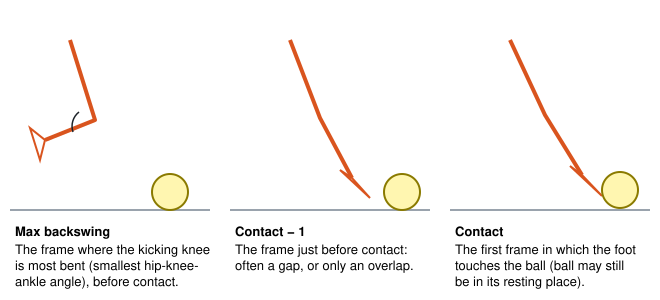
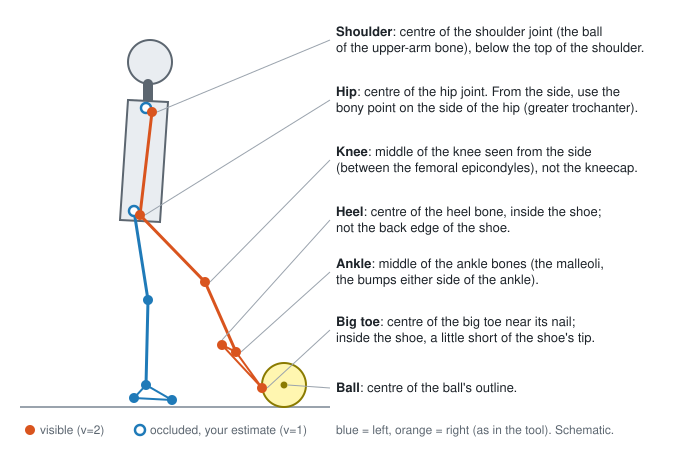

# Labelling guide

These labels are the ground truth for E1–E4: every pose model, the measurement pipeline and
Gemini are scored against them. Consistency matters more than speed. A point placed the same
way every time is worth more than a quick guess (DEC-007).

**Who labels:** only Aamir. Claude pre-fills keypoints from RTMPose and shows QA flags, but
never sets or edits a label.

## What to label

| Clip type | Clip-level fields | Keypoint frames |
|---|---|---|
| `eval` (23 clips) | kicking leg, ball direction, view OK, contact frame, max-backswing frame | 2 frames: max backswing and contact; contact − 1 is optional (DEC-014). 12 body points + the ball on each |
| `gate_only` (c26, c27, c28) | view OK; contact frame only if you can see it | none |

The 12 body points: left and right **shoulder, hip, knee, ankle, heel, big toe**. Small toes
are not labelled, because from the side a shoe hides which toe is which (DEC-013).

## Workflow in the tool

```bash
uv run python tools/label_tool.py            # all clips; or name some: ... label_tool.py c10 c01
```
The tool opens in your browser and autosaves every change to `data/labels/<clip>.json`.

1. **Clip events.** Play the clip (`Space`) and step through it (`←`/`→`). Set the kicking leg,
   the ball's direction and view OK with the buttons. On the right frames, press `B` (max
   backswing) and `C` (contact).
2. Press `Enter` to go to the keypoints. The tool opens max backswing, then contact. Contact − 1
   is optional: label it only if the budget allows (DEC-014; click it in the frame list).
3. **Each frame:** the points start where RTMPose put them. **Check every point**, not only the
   obviously wrong ones (see "Pre-fill anchoring" below). Drag wrong points, set occluded or
   unknown points (`O` / `U`), and place the ball: press `B`, then click its centre.
4. `Enter` confirms the frame and moves to the next. A frame is ground truth only once it's
   confirmed.
5. Read the **QA flags** panel before moving to the next clip.

Pinch (or ctrl+scroll) to zoom; `F` zooms to the player. Most clips are 480×360, so zoom in
until the joint fills a good part of the screen before you place it. If a clip is dark, use the
brightness slider; it changes only the display.

## Clip-level fields

**Kicking leg.** The leg that strikes the ball, as the player's own left or right. The other
leg is the plant (support) leg.

**Ball travels to.** Image left or image right: the direction the ball goes after the kick.
This sets the sign of trunk lean (DEC-006: positive = leaning forward in the kicking
direction).

**View OK (`view_ok_human`).** Answer *yes* if you could measure this kick from this camera.
The project's capture protocol (`docs/handoff/02_MVP_SPEC.md`) asks for:
- a camera side-on to the kicking direction, within about 30° of perpendicular. This is a
  protocol choice, not a published threshold (*heuristic*);
- a level camera, not moving;
- the whole body and the ball visible around contact.

Answer *no* for a camera behind or in front of the player, or a body cut off at contact. Judge
by eye; nothing is measured here. E8 scores the quality gate against your answer, which is why
Claude must never fill it in.

**Contact frame.** The first frame in which the foot touches the ball. The literature calls
this moment "ball impact" (e.g. Kellis & Katis 2007, p. 155).
- **Overlap is not contact.** In a 2D picture the shoe can cover part of the ball's outline
  before it touches the ball, because it's in front of the ball or beside it in depth. So "no
  gap" alone isn't enough. Often two frames in a row show no gap: in the first the shoe only
  overlaps the ball; in the second it's pressed against the ball's back (the side it's kicked
  from). Pick the second as contact. Signs of a real touch: the ball looks squashed or pushed,
  or by the next frame the ball has moved. (Our convention, refined after the first homework
  sitting.)
- **Contact − 1 is simply the frame before contact.** It may show a gap or an overlap; it
  doesn't need a gap.
- At contact the foot is often blurred. Use the edge of the blur nearest the ball.
- **If no frame shows the touch** (the gap closes, then in the next frame the ball has already
  moved away), set contact to the first frame in which the ball has moved, and tick "no frame
  shows the touch". The tool then still labels the frame before it as contact − 1.

**Max-backswing frame.** The frame where the kicking knee is **most bent** before contact, i.e.
where the smallest angle between thigh and shank is reached: the heel is closest to the
buttock. Kellis & Katis (2007, p. 155) describe the shank moving backwards while the thigh
already moves forward "until maximal knee flexion is achieved", after which the knee extends
towards impact. So this frame is often *after* the thigh has started forward. Don't look for
the thigh's furthest-back position. If two frames look equally bent, take the earlier one (our
convention, so you choose the same way every time).



## Where each point goes

COCO, the dataset most pose models are trained on, **names** its keypoints but doesn't define
where on the body they are. Its own annotators disagreed most on the hips: COCO's measured
per-keypoint spread is σ = 0.107 for hips, 0.087 knees, 0.089 ankles and 0.079 shoulders, in
units of person size (√ of the person's outlined area) (COCO keypoint evaluation page;
`pycocotools` `kpt_oks_sigmas`).
So we pin each point to a **joint centre** from the International Society of Biomechanics
(ISB) definitions. We then place it where that centre appears in a side view, using the
surface landmarks of a validated 2D side-view method (Fernández-González et al. 2020).

| Point | Definition (source) | Where to click in a side view |
|---|---|---|
| **Shoulder** | Glenohumeral rotation centre: the centre of the ball-and-socket shoulder joint (Wu et al. 2005, p. 983) | The centre of the rounded top of the upper arm where it meets the trunk. This is *below* the top of the shoulder (the acromion), not on it. *Our 2D reading of the ISB definition; no 2D source found.* |
| **Hip** | Centre of the hip joint (femoral head), treated as a ball and socket (Wu et al. 2002, §4.2.2, p. 545) | The bony point on the side of the hip, the greater trochanter. It's the side-view hip marker in Fernández-González et al. (2020, §2). Under shorts, estimate it from the thigh's line and the pelvis. |
| **Knee** | Midpoint between the medial and lateral femoral epicondyles (Wu et al. 2002, §4.4, p. 546) | The middle of the side of the knee (lateral femoral condyle in Fernández-González et al. 2020), roughly where the thigh and shank lines meet. **Not the kneecap**, which sits in front of the joint. |
| **Ankle** | Inter-malleolar point, midway between the tips of the medial and lateral malleoli (Wu et al. 2002, §3.2.2, p. 544) | The bony bump on the side of the ankle (external malleolus in Fernández-González et al. 2020). In a true side view the inner and outer bumps line up, so this is their midpoint. |
| **Heel** | Heel point of the foot keypoint set, placed at the inner centre rather than the surface (Jin et al. 2020, App. A; Cao et al., §4.2) | The centre of the heel bone (calcaneus), **inside** the shoe. Not the back edge of the sole or heel counter. |
| **Big toe** | "The area between the connection of the nail and skin", at the centre of the toe rather than its surface (Cao et al., §4.2) | Inside the shoe, where the big toe's nail would be: a little short of the shoe's tip, about halfway up the toe box. |
| **Ball** | Centre of the ball, as digitised in 2D/3D kicking analysis (Nunome & Ikegami 2006, p. 1) | The centre of the ball's outline. If it's blurred or squashed at contact, the centre of what you can see. |



**Finding hips and shoulders under clothing.** Both are ball-and-socket joints, and the
definitions above are the centre the bone turns about (the "rotation centre" in Wu et al.
2005). So find the pivot:
- **Hip:** follow the line down the middle of the thigh up to the pelvis. Then step through
  the backswing with `←`/`→`: the thigh swings a long way, and the point near its top that
  stays still is the hip. Place the near hip there. The far hip sits just behind it
  (*occluded*).
- **Shoulder:** the same with the arm swing: the point near the top of the upper arm that stays
  still while the arm moves.
- **Place each hip from its own leg, not from the trunk's tilt.** Trunk lean is measured from
  the hip and shoulder midpoints. If you put the hips where the lean "looks right", the label
  copies your impression of the lean instead of locating the joints, and E1/E2 would be
  scoring the model against that impression. (Our convention.)

Left and right are always the **player's** left and right, never the image's. In the tool,
blue = left, orange = right. Check the colours on every frame: pose models often swap the
near and far legs in a side view (handoff D8), and the most important correction you'll make is
un-swapping them.

## Visible, occluded, unknown

Each point gets one of COCO's three visibility flags (COCO "Data format": v=0 not labelled,
v=1 labelled but not visible, v=2 labelled and visible):

| Flag | Key | Use it when |
|---|---|---|
| **visible** (2) | `V` | You can see the body part where the point is. A joint centre is always under skin or clothing; "visible" means the part isn't hidden. |
| **occluded** (1) | `O` | Something hides the part: the other leg, the ball, an arm, the body itself (the far shoulder and hip in a side view). You can still estimate where it is from the visible limbs. Place your best estimate. |
| **unknown** (0) | `U` | You can't estimate it: off the image, hidden with no clue to its position, or too dark or blurred. **Don't guess.** The point is removed and gets no coordinates. |

Rules of thumb:
- In a side view the **far-side hip** is almost always hidden behind the near hip and pelvis:
  mark it *occluded* and place your estimate. The **far-side shoulder** is often in view when
  that arm swings forward; mark it *visible* only if you can see the shoulder itself, not just
  the arm. Both matter: trunk lean uses the midpoints of both shoulders and both hips.
- If the player kicks towards image right, their **right** side faces the camera (near side)
  and their left side is the far side; kicking towards image left, it's the other way round.
- **The kicking foot's toe at contact** is often behind the ball: where the toe should be,
  you see ball, not shoe. Mark it *occluded* and place your estimate. Follow the line of
  the visible part of the shoe (laces and sole), and use the frames just before contact
  (`←`) to see how long the foot is and which way it points.
- A **blurred** limb is not occluded. If you can tell where the joint is inside the blur, keep
  it *visible*; if the blur hides it but the limb's line still tells you, use *occluded*; if
  not even that, *unknown*.
- Look at the build-up: in the keypoint screen, `←`/`→` (shift = 10 frames), `Space` or the
  scrubber show other frames, with your points for the labelled frame drawn faint on top. Use
  this to see where a blurred or hidden joint is going, then press `/` (or `Enter`) to go back
  and place it on the frame you're labelling.

## Pre-fill anchoring

The points start at RTMPose's guesses. Accepting a guess unchecked turns a model output into
"ground truth", and E1 would then flatter RTMPose. So:
- look at every point at a zoom where you could tell a few pixels apart;
- move it if it's off, even slightly;
- the tool keeps the pre-fill next to your label, so E1 can report how far labels moved from it
  and how often a point was left exactly where RTMPose put it (DEC-013).

## QA flags

The panel lists issues for you to check. Fixing one is your call; a flag is never applied
automatically.

| Flag | Meaning |
|---|---|
| `clip_incomplete` / `frame_unconfirmed` | Something still to do. |
| `event_order` | The max-backswing frame is not before the contact frame. |
| `missing_required` | A point needed for the angles is *unknown*: both shoulders and hips, the kicking knee and ankle, the plant ankle, and the ball on the contact frame. If you can estimate it, mark it *occluded*. |
| `lr_swap_vs_model` | Your left/right pair is the model's right/left. Usually the model was wrong, but double-check. |
| `far_from_model` | A point is more than 0.5 thigh lengths from RTMPose's guess (*heuristic* threshold). Often a correct fix of a model mistake; check that it isn't a mis-drag. |
| `segment_length` | A thigh or shank is more than 20% longer in one labelled frame than another (*heuristic*). Some change is real, since a leg looks shorter when it turns away from the camera; a big jump usually means a misplaced hip, knee or ankle. |

## Blind relabel (labelling repeatability)

At least 2 days after labelling, run:
```bash
uv run python tools/label_tool.py --repeat
```
It samples 10 confirmed frames across clips (seeded) and shows them **without your first
labels**. Label them again as normal. The spread between the two passes is the floor of the
evaluation: no model can be shown to be more accurate than the labeller is consistent. For
scale only (gait, with skin markers, not kicks): in Fernández-González et al. (2020), one
rater's repeated 2D joint angles disagreed by about ±5°.

## Timing

The tool logs active time per frame and per clip's events. Seconds with no mouse or keyboard
input for 30 s are not counted (*heuristic* idle cut-off). `uv run python tools/label_tool.py
--report` prints the QA flags and timing and writes `results/labelling/timing_*.csv`.

## References

- **Cao, Z., Hidalgo, G., Simon, T., Wei, S.-E. & Sheikh, Y.** OpenPose: realtime
  multi-person 2D pose estimation using part affinity fields. arXiv:1812.08008 (the IEEE TPAMI
  version). §4.2, "Extended foot keypoint detection". <https://arxiv.org/abs/1812.08008>
- **COCO Consortium.** Data format: keypoint visibility flags v=0/1/2.
  <https://cocodataset.org/#format-data>. Keypoint evaluation: per-keypoint σ from 5,000
  redundantly annotated images. <https://cocodataset.org/#keypoints-eval>. Values as in
  `pycocotools/cocoeval.py` `Params.kpt_oks_sigmas`
  (<https://github.com/cocodataset/cocoapi>).
- **Fernández-González, P., Koutsou, A., Cuesta-Gómez, A., Carratalá-Tejada, M.,
  Miangolarra-Page, J. C. & Molina-Rueda, F. (2020).** Reliability of Kinovea® software and
  agreement with a three-dimensional motion system for gait analysis in healthy subjects.
  *Sensors* 20(11), 3154. §2 (marker placement and angle definitions).
  <https://doi.org/10.3390/s20113154> (open access, PMC7308968)
- **Jin, S., Xu, L., Xu, J., Wang, C., Liu, W., Qian, C., Ouyang, W. & Luo, P. (2020).**
  Whole-body human pose estimation in the wild (COCO-WholeBody). *ECCV 2020*. Appendix A,
  "Foot keypoints". <https://arxiv.org/abs/2007.11858>
- **Kellis, E. & Katis, A. (2007).** Biomechanical characteristics and determinants of instep
  soccer kick. *Journal of Sports Science and Medicine* 6(2), 154–165. pp. 154–155.
  <https://pmc.ncbi.nlm.nih.gov/articles/PMC3786235/>
- **Nunome, H. & Ikegami, Y. (2006).** Kinematics of soccer instep kicking: a comparison of
  two-dimensional and three-dimensional analysis. *XXIV ISBS Symposium*, Salzburg. p. 1
  (digitised landmarks: hip, knee, ankle, heel, toe, ball centre).
  <https://ojs.ub.uni-konstanz.de/cpa/article/view/135>
- **Wu, G. et al. (2002).** ISB recommendation on definitions of joint coordinate system of
  various joints for the reporting of human joint motion, part I: ankle, hip, and spine.
  *Journal of Biomechanics* 35, 543–548. §3.2.2, §4.2.2, §4.4.
  <https://isbweb.org/activities/standards>
- **Wu, G. et al. (2005).** ISB recommendation on definitions of joint coordinate systems of
  various joints for the reporting of human joint motion, part II: shoulder, elbow, wrist and
  hand. *Journal of Biomechanics* 38, 981–992. p. 983 (GH). <https://isbweb.org/activities/standards>
